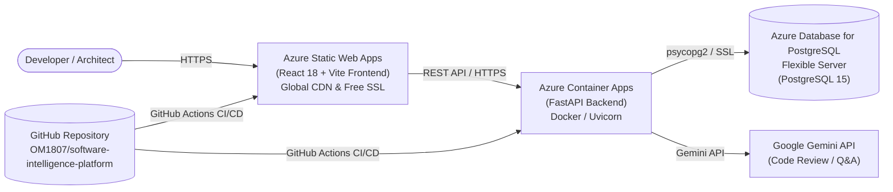

# Azure Deployment Guide for Software Intelligence Platform (SIP)

This guide walks you through deploying the **Software Intelligence Platform (SIP)** to Microsoft Azure using automated CI/CD with **GitHub Actions**.

---

## 🏛️ Production Architecture



| Layer | Azure Service | Recommended SKU / Tier | Purpose |
| :--- | :--- | :--- | :--- |
| **Frontend** | **Azure Static Web Apps (SWA)** | Free Tier ($0/mo) | High-speed global edge distribution, automated SPA routing, free managed SSL certificate. |
| **Backend** | **Azure Container Apps (ACA)** | Consumption Tier | Serverless microservice hosting for FastAPI container, auto-scaling, integrated HTTPS ingress. |
| **Container Registry** | **Azure Container Registry (ACR)** | Basic Tier | Private registry to store and version Docker images built by GitHub Actions. |
| **Database** | **Azure PostgreSQL (Flexible Server)** | Burstable B1ms | Managed PostgreSQL 15, automated daily backups, SSL enforcement. |

---

## ⚡ Option 1: Automated Setup via Azure CLI & Script (Fastest)

### Step 1: Install Azure CLI (if not already installed)
In PowerShell:
```powershell
winget install Microsoft.AzureCLI
```
*(Restart your PowerShell terminal after installation)*

### Step 2: Log in to Azure
```powershell
az login
```

### Step 3: Run the Provisioning Script
From the project root:
```powershell
.\scripts\azure-provision.ps1 -ResourceGroup "rg-sip-prod" -Location "eastus"
```
The script will:
1. Create the Azure Resource Group (`rg-sip-prod`).
2. Provision an Azure Container Registry (ACR).
3. Create Azure Database for PostgreSQL (Flexible Server) and initialize the `sip_database`.
4. Deploy the Azure Container Apps Environment and Backend service.
5. Create Azure Static Web Apps for the React frontend.
6. Print the exact secrets to configure in your GitHub Repository.

---

## 🖥️ Option 2: Azure Portal Setup (Manual Walkthrough)

If you prefer using the Azure Portal UI ([portal.azure.com](https://portal.azure.com)):

### 1. Create a Resource Group
- Go to **Resource groups** -> **+ Create**.
- Name: `rg-sip-prod`, Region: `East US` (or your preferred region).

### 2. Create Azure Database for PostgreSQL (Flexible Server)
- Search for **Azure Database for PostgreSQL flexible servers** -> **Create**.
- Server name: `psql-sip-prod`
- Version: `15`
- Compute + Storage: **Burstable**, `Standard_B1ms` (1 vCore, 2 GiB RAM, 32 GiB storage)
- Authentication: Set Admin username (e.g. `sip_user`) and a secure password.
- Networking: Check **Allow public access to this server** and enable **Allow public access from any Azure service within Azure to this server**.
- After creation, open **Databases** tab and click **+ Add** -> Name: `sip_database`.

### 3. Create Azure Container Registry (ACR)
- Search for **Container registries** -> **Create**.
- Registry name: `acrsipprod` (must be globally unique and alphanumeric).
- SKU: `Basic`.
- After creation, navigate to **Settings -> Access keys** and enable **Admin user**. Note down the **Login server**, **Username**, and **password**.

### 4. Create Azure Container App (Backend)
- Search for **Container Apps** -> **Create**.
- Container App Name: `app-sip-backend`.
- Target port: `8000`.
- Ingress: Enable external ingress on port `8000`.
- Environment Variables:
  - `ENVIRONMENT=production`
  - `DATABASE_URL=postgresql://sip_user:<PASSWORD>@<SERVER_NAME>.postgres.database.azure.com:5432/sip_database?sslmode=require`
  - `SECRET_KEY=<RANDOM_HEX_64_CHARS>`
  - `LLM_API_KEY=<YOUR_GEMINI_API_KEY>`

### 5. Create Azure Static Web App (Frontend)
- Search for **Static Web Apps** -> **Create**.
- Name: `swa-sip-frontend`.
- Plan type: **Free**.
- Deployment details: Select **GitHub**, authorize your repository `OM1807/software-intelligence-platform`, Branch `main`.
- Build Presets: `Custom`.
  - App location: `frontend`
  - Api location: *(leave empty)*
  - Output location: `dist`
- Go to **Manage deployment token** to copy the API token.

---

## 🔐 GitHub Actions Secrets Configuration

In your GitHub repository, navigate to:
**Settings** -> **Secrets and variables** -> **Actions** -> **New repository secret**:

| Secret Name | Value Description |
| :--- | :--- |
| `ACR_LOGIN_SERVER` | e.g., `acrsip12345.azurecr.io` |
| `ACR_USERNAME` | ACR admin username |
| `ACR_PASSWORD` | ACR admin password |
| `AZURE_RESOURCE_GROUP` | `rg-sip-prod` |
| `AZURE_CONTAINER_APP_NAME` | `app-sip-backend` |
| `VITE_BACKEND_URL` | e.g., `https://app-sip-backend.<region>.azurecontainerapps.io` |
| `AZURE_STATIC_WEB_APPS_API_TOKEN` | Deployment token from Azure Static Web App |

Whenever you push to the `main` branch, the `.github/workflows/azure-deploy.yml` workflow will:
1. Run backend tests (`pytest backend/tests/`).
2. Build and push the backend Docker container to ACR.
3. Update Azure Container App with zero downtime.
4. Run frontend tests & TypeScript validation (`tsc --noEmit`).
5. Build the production React bundle and deploy it to Azure Static Web Apps CDN.

---

## 🗄️ Database Migrations on Azure

Once the Azure PostgreSQL database is online, run Alembic migrations against the remote database:

```powershell
$env:DATABASE_URL = "postgresql://sip_user:<PASSWORD>@<SERVER_NAME>.postgres.database.azure.com:5432/sip_database?sslmode=require"
cd backend
..\.venv\Scripts\python.exe -m alembic upgrade head
```

---

## 🧪 Post-Deployment Verification

1. **Backend Health Check**:
   ```bash
   curl https://<your-backend-app>.azurecontainerapps.io/health
   # Expected: {"status":"ok"}
   ```
2. **OpenAPI Documentation**:
   Navigate to `https://<your-backend-app>.azurecontainerapps.io/docs` in your browser.
3. **Frontend Application**:
   Navigate to `https://<your-static-web-app>.azurestaticapps.net`. Test signing in with a Personal Access Token (PAT) and importing a repository.
